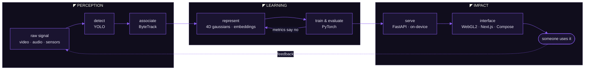
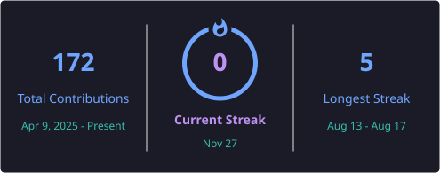

<div align="center">



# ⚡ SHARVAN.OS


**Computer Vision · Machine Learning · AI Engineering**

`PERCEPTION` → `LEARNING` → `REAL-WORLD IMPACT`

<p>
  <a href="https://github.com/sharvan-m"></a>
  <a href="https://www.linkedin.com/in/sharvan-m/"></a>
  
</p>

<sub>`STATUS: online` &nbsp;·&nbsp; `UPTIME: always learning` &nbsp;·&nbsp; `EXIT CODE: 0`</sub>

</div>

---

## `▞ whoami`

I'm **Sharvan M**, a student at KPR Institution in Coimbatore who builds computer-vision and machine-learning systems that do something useful outside a notebook. Lately that means dynamic 3D scene reconstruction, precision-livestock analytics, and voice-first assistants — models wired into real interfaces, not just metrics on a slide.

I like the whole path: dataset → model → inference → the thing a person actually clicks.

---

## `▞ neofetch`

```text
       ███████╗     ██████╗ ███████╗     sharvan@sharvan-os
       ██╔════╝    ██╔═══██╗██╔════╝     ──────────────────────────────────────────
       ███████╗    ██║   ██║███████╗     os ········· SHARVAN.OS v2.0 · rolling
       ╚════██║    ██║   ██║╚════██║     kernel ····· vision-6.1-cuda
       ███████║ ██╗╚██████╔╝███████║     host ······· KPR Institution · Coimbatore
       ╚══════╝ ╚═╝ ╚═════╝ ╚══════╝     shell ······ python3 · pytorch · kotlin

   uptime ····· learning, building, experimenting
   packages ··· 4d gaussians · goat herds · voice agents
   cpu ········ curiosity @ 4.8 GHz   (turbo mode: caffeine)
   gpu ········ cuda · yolo · bytetrack
   memory ····· ideas: 92% used / 8% free
   theme ······ violet-on-black  [#8B5CF6]
```

---

## `▞ ps aux` — what's running

```text
USER     PID   STAT  %FOCUS  COMMAND
sharvan  0001  R       34.2  4d_scene_reconstruction   --export .4dv --viewer webgl2
sharvan  0002  R       27.8  goat_precision_livestock  --track --weigh --famacha
sharvan  0003  R       21.5  freakyyy                  --voice --windows --android
sharvan  0004  S        9.1  machine_learning_tasks    --genre --churn --spam
sharvan  0005  S        7.4  misc                      --java-food-order --py-drills

R = running    S = sleeping (not dead)    expand a process below ↓
```

<details>
<summary><b>🧊 <code>0001</code> &nbsp;4D Scene Reconstruction</b> &nbsp;—&nbsp; <sub>dynamic scenes → a format you can walk through</sub></summary>

<br>

Reconstructs **dynamic** scenes from multi-view video using 4D Gaussian Splatting, then exports them to a traversable `.4dv` format with an interactive **WebGL2** viewer — so the result isn't a render, it's a scene you can move inside.

```text
  multi-view video → 4D gaussians → .4dv container → WebGL2 viewer
```

**Stack** · `Python` `C++` `CUDA` `PyTorch` `WebGL2`
**Repo** · [4D_Scene_Reconstruction_and_A_Traversable_Video_Format ↗](https://github.com/sharvan-m/4D_Scene_Reconstruction_and_A_Traversable_Video_Format)

</details>

<details>
<summary><b>🐐 <code>0002</code> &nbsp;Goat Precision Livestock</b> &nbsp;—&nbsp; <sub>vision instead of a weighing scale</sub></summary>

<br>

A computer-vision platform for **multi-animal tracking**, **non-contact weight estimation**, and **ocular FAMACHA** screening — herd health read from a camera instead of handling every animal.

```text
  camera → YOLO detect → ByteTrack ids → weight + FAMACHA → dashboard
```

**Stack** · `Python` `YOLO` `ByteTrack` `FastAPI` `Next.js`
**Repo** · [Goat_Precision_Livestock ↗](https://github.com/sharvan-m/Goat_Precision_Livestock)

</details>

<details>
<summary><b>🤖 <code>0003</code> &nbsp;FREAKYYY</b> &nbsp;—&nbsp; <sub>a voice-first assistant that actually runs my machines</sub></summary>

<br>

A voice-first personal assistant for **Windows and Android**: local AI, workflow automation, and a secure cross-device link so one spoken command can land on either screen.

```text
  wake word → intent parse → local model → device action → spoken reply
```

**Stack** · `Python` `Kotlin` `Jetpack Compose` `SQLite` `WebSockets`
**Repo** · [FREAKYYY ↗](https://github.com/sharvan-m/FREAKYYY)

</details>

<details>
<summary><b>📊 <code>0004</code> &nbsp;Machine Learning Tasks</b> &nbsp;—&nbsp; <sub>the fundamentals, done properly</sub></summary>

<br>

Hands-on ML: movie-genre classification, customer-churn prediction, SMS-spam detection — feature engineering and honest evaluation rather than one accuracy number.

**Stack** · `Python` `scikit-learn` `TF-IDF` `LinearSVC` `Random Forest`
**Repo** · [Machine_Learning_Tasks ↗](https://github.com/sharvan-m/Machine_Learning_Tasks)

</details>

<details>
<summary><b>🗂 <code>0005</code> &nbsp;Background jobs</b> &nbsp;—&nbsp; <sub>smaller things worth keeping</sub></summary>

<br>

- **Restaurant Food Order** — ordering system in `Java`
- **Python Programming Tasks** — language and algorithm drills

</details>

---

## `▞ cat /proc/modules`



---

## `▞ trace --pipeline`

How a project moves through this system:



---

## `▞ dmesg | tail`

```text
[ now  ] pushing 4d reconstruction toward longer, messier captures
[ now  ] hardening FREAKYYY's cross-device link
[ next ] better non-contact weight estimation under occlusion
[ next ] deeper into multi-object tracking under identity switches
[ idle ] open to collaborating on applied CV / ML work
```

---

## `▞ telemetry`

<div align="center">



<br />


</div>

---

## `▞ systemctl status contribution.daemon`

<div align="center">

<picture>
  <source media="(prefers-color-scheme: dark)" srcset="https://raw.githubusercontent.com/sharvan-m/sharvan-m/output/github-contribution-grid-snake-dark.svg" />
  <source media="(prefers-color-scheme: light)" srcset="https://raw.githubusercontent.com/sharvan-m/sharvan-m/output/github-contribution-grid-snake.svg" />
  
</picture>

<sub>`● active (running)` &nbsp;·&nbsp; restarts on coffee</sub>

</div>

---

## `▞ env`

```text
ROLE=computer vision · machine learning
LOCATION=Coimbatore, Tamil Nadu, India
OPEN_TO=applied CV/ML collaboration, research-flavoured builds
REACH_ME=linkedin.com/in/sharvan-m
```

<div align="center">

### Building intelligence, one experiment at a time.

<sub><i>Stay curious. Keep building. Make it useful.</i></sub>

<br>

<a href="https://github.com/sharvan-m?tab=repositories">Explore repositories ↗</a> &nbsp;·&nbsp;
<a href="https://www.linkedin.com/in/sharvan-m/">Connect on LinkedIn ↗</a>

<br><br>

<code>sharvan@sharvan-os:~$ shutdown -h never</code>

</div>
